# AACP CEX Off-Chain Trading — Sequence Diagram

This diagram shows the complete lifecycle of a CEX capital-entrusted job under the AACP CEX Integration Extension (whitepaper §10.10–10.11). The Client delegates a trade-only API key into a Platform-hosted TEE gateway, the Provider runs a private strategy on its own infrastructure and sends signed order intents to the gateway, and settlement is anchored on-chain via zkTLS + zkVM.

```mermaid
sequenceDiagram
    autonumber
    participant C as Client<br/>(capital owner)
    participant K as AACP Contracts<br/>(Staking/Escrow/Dispute)
    participant P as Provider<br/>(own infrastructure)
    participant PL as Platform<br/>(TEE Host)
    participant T as TEE Gateway<br/>(enclave)
    participant E as Evaluator<br/>(zkVM)
    participant B as Binance / CEX

    rect rgb(240, 248, 255)
    Note over C,B: Phase 1 — Job Creation
    C->>K: createJob(capital, stopLoss, targetReturn,<br/>perfFee, mgmtFee, deadline,<br/>maxDailyTrades, maxFeeRate, maxPositionSize)
    C->>K: fundEscrow(managementFee)
    K->>K: lock Client stake (budget × 5% ÷ R)
    K-->>C: jobId
    end

    rect rgb(245, 255, 245)
    Note over C,B: Phase 2 — Bid & Selection
    P->>K: inspect job params + Guard whitelist
    P->>K: bid(jobId)
    K->>K: lock Provider stake<br/>(C × S × η × α / (p × R) — §10.11)
    K-->>P: bid accepted
    end

    rect rgb(255, 250, 240)
    Note over C,B: Phase 3 — TEE Gateway Provisioning
    K->>PL: provisionEnclave(jobId)
    PL->>T: spawn enclave (audited gateway binary)
    T->>T: generate ephemeral keypair
    T->>PL: attestation + pubKey + MRENCLAVE
    PL->>K: post attestation on-chain
    K-->>C: enclave endpoint + attested pubKey
    K-->>P: enclave endpoint + attested pubKey
    end

    rect rgb(255, 245, 250)
    Note over C,B: Phase 4 — API Key Handoff
    C->>B: create trade-only API key<br/>(no withdraw, IP whitelist = TEE egress)
    B-->>C: apiKey + apiSecret
    C->>C: verify TEE attestation<br/>(MRENCLAVE matches audited binary)
    C->>T: encrypt(apiKey, TEE pubKey)<br/>via on-chain metadata
    T->>T: decrypt inside enclave<br/>(plaintext NEVER leaves)
    T->>B: GET /account (self-test)
    B-->>T: balance + permissions
    T->>T: assert permissions == trade-only<br/>assert balance ≥ declared capital
    T->>K: emit GatewayReady(jobId)
    end

    rect rgb(250, 245, 255)
    Note over C,B: Phase 5 — Trading Loop until deadline
    loop every order
        P->>P: private strategy decides trade<br/>(any hardware, source never shared)
        P->>T: orderIntent {action, symbol, qty,<br/>type, nonce, providerSig}
        T->>T: verify providerSig (ERC-8004 identity)
        T->>T: check maxDailyTrades<br/>cumulative maxFeeRate<br/>maxPositionSize<br/>banned symbols
        alt limit breached
            T-->>P: reject(reason)
        else valid
            T->>B: signed order forwarded
            B-->>T: execution report
            T->>B: GET /account/balance
            B-->>T: post-trade balance
            T->>T: assert totalValue ≥ stopLoss
            T->>T: append to attested log (IPFS)
            T-->>P: TEE-attested execution report
        end
    end
    end

    rect rgb(255, 255, 240)
    Note over C,B: Phase 6 — Periodic Snapshots, parallel to trading
    loop every snapshotInterval
        T->>B: GET /account balance + positions
        B-->>T: balance, positions, P&L
        T->>T: build attested snapshot
        T->>K: submit snapshotHash on-chain<br/>(full data on IPFS)
        opt drawdown ≥ stopLoss
            T->>B: cancel all open orders
            T->>K: emit StopLossTriggered(jobId)
            T->>T: stop accepting new orders → wind-down mode
        end
    end
    end

    rect rgb(240, 255, 255)
    Note over C,B: Phase 7 — Settlement at deadline or after stop-loss
    T->>B: GET /account/balance via TLS Notary
    B-->>T: TLS-signed response
    T->>T: build zkTLS proof<br/>"binance.com TLS cert proves<br/>balance = X at time T"
    T->>K: submit zkTLS proof
    E->>K: fetch proof + program
    E->>E: zkVM run:<br/>1. verify zkTLS proof<br/>2. met = (final ≥ initial × (1 + target))<br/>3. exitCode = 0 / 1
    E->>K: submit Groth16 proof + result
    K->>K: verify Groth16 on-chain
    end

    rect rgb(255, 240, 240)
    Note over C,B: Phase 8 — Distribution & Cleanup
    alt target met
        K->>P: managementFee from escrow
        K->>K: unlock Provider stake
        K->>K: reputation +5
        Note right of C: excess return split via perfFee<br/>settled on the CEX side
    else no loss but missed target
        K->>K: unlock Provider stake<br/>mgmtFee withheld per terms
    else loss
        K->>K: tiered slash per §10.11.5<br/>loss percent maps to slash percent
        K->>C: 80% of slash → Client
        K->>K: 15% → Treasury<br/>5% → Arbitrators
        K->>K: significant reputation drop
    end
    T->>T: securely delete API key
    T->>K: emit KeyDestroyed(jobId, attestation)
    C->>B: revoke API key on the exchange
    end
```

## Design Notes

1. **Phase 4 (API key handoff) is the trust root.** The Client MUST verify the TEE attestation's MRENCLAVE against the published audited gateway binary *before* releasing the encrypted API key. Skipping this check means the key could be handed to a forged enclave.

2. **Phase 5 separates fast and slow paths.** Order intents take the low-latency path Provider → TEE → CEX. Snapshots take the slow on-chain path TEE → contract. The two run in parallel and never block each other.

3. **`snapshotInterval` is the upper bound on the attack window.** A flash crash between two snapshots can pierce `stopLoss`, which is why Tier 3 jobs (capital > 100k USDC) require a 1-hour interval (§10.11.4).

4. **zkTLS is the only trusted source of final balance data.** The Evaluator does not trust the TEE's reported balance directly — the TEE merely originates the zkTLS session, and the final evidence is the Binance TLS certificate signature.

5. **Dispute path is omitted for clarity.** If a Client suspects counter-trading: file a dispute within the §8.1 window → arbitrators replay the attested logs from Phase 5/6 and the zkTLS proof from Phase 7 → standard §8.3 arbitration applies.

## Related Sections

- §10.10.3 — Three-party trust model and architecture
- §10.10.4 — Detailed lifecycle prose (this diagram is the visual companion)
- §10.10.5 — Attack vectors and defenses
- §10.10.6 — Security invariants
- §10.11 — CEX staking calculation model
