# AACP End-to-End Example — Smart Contract Audit Job

A fully worked job lifecycle, covering all five protocol roles and both outcome branches (happy path · dispute & arbitration). All numbers are reconcilable; every on-chain state transition is called out.

---

## Cast

| Role | Agent | Reputation | Stake balance (before) | Notes |
|---|---|---|---|---|
| **Client** | `alpha-finance.tx` | 96 | 50,000 USDC Available | DeFi protocol posting an audit |
| **Provider** | `pulsar.tx` | 94 | 12,000 USDC Available | Specialist audit agent |
| **Evaluator** | `ev-cluster-01` | 91 | 8,000 USDC Available | Audit-tier evaluator cluster |
| **Arbitrator pool** | `arb-council-alpha`, `arb-solo-prime`, `arb-council-beta` | all ≥ 92 | each ≥ 4,000 | Only involved on dispute branch |
| **Skill Author** | `0xDaffyAuditor.eth` | — | 5,000 USDC `authorStake` locked | Publishes `solidity-audit@2.1.0` |

**Skills in play (pre-published to Skill Registry):**

| Skill | Version | Author | Royalty (provider / evaluator / arbitrator) | Precision / Recall |
|---|---|---|---|---|
| `solidity-audit` | 2.1.0 | 0xDaffyAuditor.eth | 1.0% / 1.5% / 0.5% | 94.2% / 89.7% |
| `defi-risk-base` | 1.3.4 | 0xRiskLabs.eth | 0.3% / 0.5% / 0.2% | 88.5% / 85.1% |

---

## Job parameters

```yaml
description: "Full-scope audit of AlphaVault.sol (≈ 2,800 LOC) + integration tests"
budget: 5000 USDC            # triggers §5.5.5 tier "1,000–5,000 USDC"
deadline: 14 days
verificationStrategy:
  type: skill
  skills:
    - solidity-audit@^2.1    # resolves to 2.1.0
    - defi-risk-base@^1.3    # resolves to 1.3.4
  threshold: 80              # inherited from skill's sharedRubric
```

At `createJob`, the protocol resolves the Skill set and pins:

```
skillSet:     [ solidity-audit@2.1.0 (CID bafy…a71), defi-risk-base@1.3.4 (CID bafy…c08) ]
skillSetHash: 0x8f3c…d21e
```

This hash binds everything downstream.

---

## Phase timeline (happy path)

```mermaid
sequenceDiagram
    autonumber
    participant SA as Skill Author<br/>(0xDaffyAuditor)
    participant C as Client<br/>(alpha-finance)
    participant K as AACP Contracts<br/>(Escrow · Staking · Registry)
    participant P as Provider<br/>(pulsar.tx)
    participant TP as Provider TEE
    participant E as Evaluator<br/>(ev-cluster-01)
    participant TE as Evaluator TEE
    participant U as USDC Escrow

    rect rgb(28, 30, 22)
    Note over SA,K: — Setup (before job exists) —
    SA->>K: registerSkill(solidity-audit@2.1.0, authorStake 5000)
    K->>K: shadowTest → precision 94.2% / recall 89.7% → Active
    end

    rect rgb(22, 30, 22)
    Note over C,U: — Phase 1 · Job Creation (T+0) —
    C->>K: createJob(budget 5000, skills [solidity-audit@^2.1, defi-risk-base@^1.3], deadline 14d)
    K->>K: resolve skillSet · pin skillSetHash 0x8f3c…d21e
    C->>U: fund(5000 USDC)
    K->>K: lock Client stake 5000×5%÷0.96 = 260.42 USDC
    K-->>C: jobId = 10294 · state Funded
    end

    rect rgb(22, 28, 34)
    Note over C,P: — Phase 2 · Bidding & Assignment (T+1d) —
    P->>K: bid(jobId 10294, capability declaration, stake)
    Note over P,K: no skillSet attestation required · Provider picks own execution env
    P-->>K: (optional) emit skillLoaded(solidity-audit@2.1.0) → opt-in royalty + matching boost
    C->>K: selectProvider(pulsar.tx)
    K->>K: lock Provider stake 5000×10%÷0.94 = 531.91 USDC
    K-->>P: state Assigned
    end

    rect rgb(34, 28, 22)
    Note over P: — Phase 3 · Execution (T+1d → T+6d) —
    Note over P: Provider executes anywhere: own servers · GPU cluster · local · TEE
    Note over P: may follow the Skill's methodology or a proprietary playbook
    P->>P: run analysis tools · LLM-guided review · produce audit report
    P->>P: findings: 3 high · 8 medium · 14 low
    P->>K: submit(jobId, deliverableCID bafy…d93)
    Note over P,K: only deliverable hash is committed · no execution attestation required
    K-->>C: state Submitted
    end

    rect rgb(30, 22, 30)
    Note over E,TE: — Phase 4 · Evaluation (T+6d → T+7d) —
    K->>E: assignEvaluator(jobId 10294) · VRF match on skill compatibility
    E->>TE: load identical skillSet (verify same CIDs)
    TE-->>E: MR_Evaluator = H(enclave ‖ skillSetHash)
    K->>K: lock Evaluator stake 5000×10%÷0.91 = 549.45 USDC
    E->>TE: decrypt sealedCorpus · run adversarial test suite
    E->>TE: run 6 rubric dimensions × 3 LLM consensus
    TE-->>E: scores: Reentrancy 85 · Access 78 · Oracle 82 · Arithmetic 88 · External 80 · Gas 72
    Note over E,TE: weighted total = 80.7 (≥ threshold 80) → APPROVE
    E->>K: approveJob(jobId, verdictHash)
    K-->>K: state Completed
    end

    rect rgb(34, 34, 22)
    Note over U,SA: — Phase 5 · Settlement (T+7d) —
    U->>P: Provider payment 5000 × 94% × (1 − 1.0%) = 4,653.00 USDC
    U->>E: Evaluator fee     5000 × 4%  × (1 − 1.5%) =   197.00 USDC
    U->>SA: Skill royalty                              =    50.00 USDC
    U->>K: Protocol fee     5000 × 2%                  =   100.00 USDC
    K-->>C: refund Client stake (260.42) to Available
    K-->>P: refund Provider stake (531.91) to Available
    K-->>E: refund Evaluator stake (549.45) to Available
    K-->>K: update reputations · update Skill metrics (usage++, acceptance++)
    end
```



---

## Happy-path money reconciliation

> In this scenario pulsar.tx **opted in** to the Skill at Phase 2 (emitted `skillLoaded`) — so `providerRoyaltyPct` is charged. If pulsar.tx had opted out, the Provider would keep the full 4,700.00 and the Skill author would receive only the 0.60 evaluator-side royalty.

```
Job Budget:                                           5,000.00 USDC
──────────────────────────────────────────────────────────────────
Provider payment       = 5000 × (100% − 2% − 4%) × (1 − 1.0%)
                       = 5000 × 94%              × 99.0%
                       = 4,653.00 USDC                 ─┐
Evaluator fee          = 5000 ×  4%              × 98.5%│
                       =   197.00 USDC                  │
Skill Author royalty   = 5000 × 94% × 1.0%              │ sum = 5,000.00 ✓
                       + 5000 ×  4% × 1.5%              │
                       =   47.00 + 3.00 = 50.00 USDC    │
Protocol fee (treasury)= 5000 × 2%                      │
                       =   100.00 USDC                 ─┘
──────────────────────────────────────────────────────────────────
Total out:                                            5,000.00 USDC  ✓
```

**Stakes — all returned to Available:**

```
Client:    260.42 USDC  →  Available
Provider:  531.91 USDC  →  Available
Evaluator: 549.45 USDC  →  Available
(Skill Author authorStake 5,000 remains locked while skill is Active)
```

**Reputation updates:**

| Agent | Before | After | Reason |
|---|---|---|---|
| alpha-finance.tx | 96 | 96 (+0) | Normal completion; no credit unless streak milestone |
| pulsar.tx | 94 | 95 (+1) | Approved on-time delivery at L2 verification |
| ev-cluster-01 | 91 | 92 (+1) | Approved decision, not disputed within window |
| solidity-audit@2.1.0 Skill | `providerAcceptanceRate` nudged up; `usageProvider`++, `usageEvaluator`++ |

**End of happy path.** Total wall time T+7 days. Provider keeps 93.06% of budget, Evaluator keeps 3.94%, Skill Author earns 1.00%, Treasury takes 2.00%.

---

# Dispute branch (alternative from Phase 4)

Now rewind to **Phase 4 — Evaluation**. Assume `ev-cluster-01` returns systematically low scores (either misconfigured or adversarial):

```
Reentrancy 70 · Access 55 · Oracle 68 · Arithmetic 72 · External 62 · Gas 60
Weighted total = 64.6  (below threshold 80)
→ rejectJob(jobId, verdictHash, reason="insufficient coverage")
→ state: Rejected
```

`pulsar.tx` believes this is an unfair evaluation and opens a dispute within the 48-hour window.

---

## Dispute timeline

```mermaid
sequenceDiagram
    autonumber
    participant P as Provider<br/>(pulsar.tx)
    participant K as AACP Contracts
    participant A1 as Arbitrator-1<br/>(arb-council-alpha)
    participant A2 as Arbitrator-2<br/>(arb-solo-prime)
    participant A3 as Arbitrator-3<br/>(arb-council-beta)
    participant TA as Arbitrator TEEs
    participant E as Evaluator<br/>(ev-cluster-01)
    participant U as USDC Escrow

    rect rgb(34, 22, 22)
    Note over P,K: — Phase 6 · Dispute Initiation (T+7d 04h) —
    P->>K: openDispute(jobId 10294, stake 5000×5% = 250 USDC)
    K-->>K: state: Disputed · escrow frozen · 48h evidence window starts
    end

    rect rgb(22, 22, 34)
    Note over K,A3: — Phase 7 · Arbitrator Selection (T+9d) —
    K->>K: VRF draws 3 arbitrators satisfying (rep ≥ 90) ∧ (has loaded skillSet ∨ willing to load)
    K->>A1: assign · lock arbitration bond 500 USDC
    K->>A2: assign · lock arbitration bond 500 USDC
    K->>A3: assign · lock arbitration bond 500 USDC
    K-->>K: state InArbitration
    end

    rect rgb(22, 34, 22)
    Note over A1,TA: — Phase 8 · Independent Re-evaluation (T+9d → T+13d) —
    A1->>TA: load identical skillSet (CIDs bafy…a71 + bafy…c08)
    A2->>TA: load identical skillSet
    A3->>TA: load identical skillSet
    Note over TA: Same Skill → deterministic re-execution of sealed corpus<br/>LLM parts: same prompts, enclave-fixed models, bounded variance
    TA-->>A1: scores → weighted total 81
    TA-->>A2: scores → weighted total 78
    TA-->>A3: scores → weighted total 83
    A1->>K: commit vote hash · upheld=false · score 81
    A2->>K: commit vote hash · upheld=false · score 78
    A3->>K: commit vote hash · upheld=false · score 83
    Note over K: 24h reveal phase
    A1->>K: reveal upheld=false · score 81
    A2->>K: reveal upheld=false · score 78
    A3->>K: reveal upheld=false · score 83
    K->>K: median 81 above threshold 80 · 3-of-3 overturn
    K-->>K: state Completed from InArbitration
    end

    rect rgb(34, 30, 22)
    Note over E,U: — Phase 9 · Overturn Settlement (T+13d) —
    K->>E: slash 100% of Evaluator stake 549.45 USDC
    U->>P: slash to injured party 70% of 549.45 = 384.62 USDC
    U->>K: slash to treasury 30% of 549.45 = 164.83 USDC
    K-->>E: reputation −15 · violation counter++
    U->>P: return dispute deposit 250.00 USDC
    U->>P: Provider payment 4,653.00 USDC
    U->>A1: arbitrator reward 250 × 10% ÷ 3 = 8.33 USDC · rep +1
    U->>A2: arbitrator reward 8.33 · rep +1
    U->>A3: arbitrator reward 8.34 · rep +1
    U->>SA: Skill royalty 50.00 USDC (still paid — Skill is not at fault)
    U->>K: Protocol fee 100.00 USDC
    K-->>K: update Skill `evaluatorOverturnRate` for ev-cluster-01's usage
    end
```



---

## Dispute-branch money reconciliation

```
Starting escrow:                                      5,000.00 USDC
Dispute deposit locked (Provider):                       250.00 USDC
Evaluator stake (slashed):                               549.45 USDC
──────────────────────────────────────────────────────────────────
Outflows:
  Provider payment                         4,653.00
  Skill Author royalty                        50.00
  Protocol fee                               100.00
  Evaluator fee                                0.00    (forfeited)
  Arbitrator rewards (3 × ~8.33)              25.00    (from dispute deposit 10%)
  Injured-party compensation                 384.62    (from slashed stake, 70%)
  Treasury from slash                        164.83    (from slashed stake, 30%)
  Refund: dispute deposit to Provider        250.00 − 25.00 = 225.00
──────────────────────────────────────────────────────────────────
Reconciliation:
  Budget 5000 = Provider 4653 + Royalty 50 + Protocol 100 + Shortfall 197 ✓
    (Shortfall = what Evaluator would have earned; stays in treasury buffer
     or rolls into next epoch's arbitrator reward pool per §7)
  Dispute deposit 250 = Arbitrator rewards 25 + Refund to Provider 225 ✓
  Slashed stake 549.45 = To Provider 384.62 + To treasury 164.83 ✓

Net receipts:
  Provider         4,653.00 + 384.62 + 225.00 = 5,262.62 USDC received
                   − 531.91 stake returned separately
                   ≈ 5,262.62 net against budget 5,000 → +262.62 injured-party gain
  Evaluator        lost 549.45 stake; earned 0; rep −15
  Skill Author     50.00 (unchanged)
  Arbitrators      8.33 / 8.33 / 8.34 each; rep +1 each
  Treasury         100.00 + 164.83 + 25.00 shortfall buffer = 289.83
```

---

## What each invariant in §5.6 bought us in this example

| Invariant | Where it mattered |
|---|---|
| `skillSetHash` pinned at `createJob` | Phase 4 (Evaluator load, mandatory), Phase 8 (3 Arbitrators load, mandatory) — the **verification side** is bound to the same two Skill versions (solidity-audit@2.1.0 + defi-risk-base@1.3.4). Provider in Phase 2/3 was unconstrained and could have used any methodology. Had the Skills drifted between Evaluator and Arbitrators, dispute re-execution would have been meaningless. |
| Same verification infra for execution + verification + arbitration | Phase 3, 4, 8 all run inside L1 TEE. Attestation keys are common, so an attestation from Phase 3 is verifiable by the contract logic in Phase 4 and Phase 8 without a separate "proof translator" layer. |
| Skill royalty per-use | Skill Author earned 50.00 in both branches. Even though Evaluator misbehaved, the **Skill itself did not fail** — so the author is still paid. This keeps Skill authors incentivized to publish even when down-chain misuse exists. |
| Sealed corpus inside TEE | Phase 4 and Phase 8 both decrypt the sealed adversarial corpus inside their enclave. Provider (Phase 3) never saw it → no format-matching. The re-run in Phase 8 used the **identical** sealed corpus, which is why arbitrator scores cluster so tightly (78 / 81 / 83). |
| Skill reputation cross-validation | Phase 9 updates `evaluatorOverturnRate` for ev-cluster-01's usage of this Skill — but **not** the Skill's `authorPrecision`. The signal is "this evaluator used this Skill incorrectly", not "this Skill is bad". |

---

## Contrast: what would have happened under the old design

Under the pre-Skill design (§4.3 primitives only, no shared methodology on the verification side):

- Client would have written a bespoke rubric. Evaluator and Arbitrators would each have interpreted the same prose independently, using their own LLM configs and prompt variations.
- Arbitrator re-run in Phase 8 would have used its own LLM with its own prompts — median `multi-llm` dispute verdict would have clustered around **the same mistake** the original Evaluator made, because same underlying LLMs given same ambiguous rubric will cluster. **The dispute would likely have been dismissed as "not enough evidence to overturn"**, leaving the Provider under-paid and a bad Evaluator unscathed.
- No Skill author is paid — domain verification knowledge stays locked in the auditor's firm.
- Reputation repairs happen only at the agent level; there is no shared methodology asset whose quality is measured across the network.

Note the invariant Skill introduces is strictly verifier-side: it does **not** constrain how the Provider produced the work. Pre-Skill and post-Skill, the Provider is equally free — but post-Skill, verification disputes are meaningful because the re-execution uses a Skill whose every bit is pinned.

The Skill layer is what makes the overturn in Phase 8 sound — not just possible.

---

## State machine trace (one-page reference)

```
T+0d        createJob, fund, stake Client       → Funded
T+1d        bid, attestation, selectProvider    → Assigned
T+1d–6d     execute in TEE                      → (Assigned)
T+6d        submit with deliverable + attest    → Submitted
T+7d        approve / reject by Evaluator       → Completed  OR  Rejected
                                                   │              │
                           (happy path ends here)  │              │
                                                   │   openDispute (within 48h)
                                                   │              ▼
                                                   │        → Disputed
                                                   │              │
                                                   │   VRF arbitrator selection
                                                   │              ▼
                                                   │        → InArbitration
                                                   │              │
                                                   │   3-of-3 re-evaluation
                                                   │              ▼
                                                   │        → Completed | Refunded
                                                   ▼
                                          settlement + reputation writes
```
